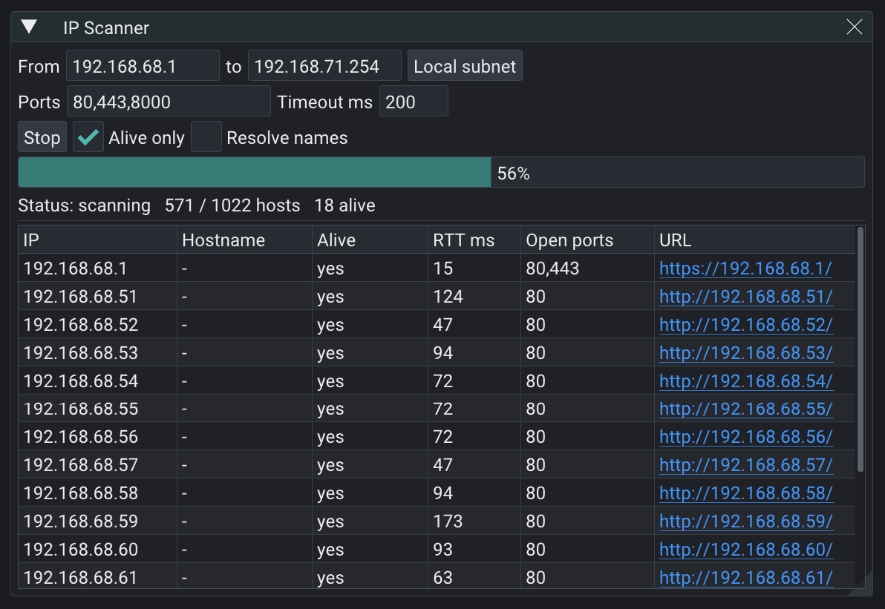

# rigNetScan



LAN TCP connect scan for controller troubleshooting.
Sockets stay in this pack, never on the POD.

- `CNetScan` — range, ports, timeout, `running`
- `CNetHost` — one IPv4 row (alive, RTT, open ports)
- `IpScannerWindow` — one registerable panel (needs **rigImGui**)
- Non-blocking TCP connect in Update (chunked)
- Range capped at 4096 addresses. Default ports `80,443,8000`

## Add the panel to an app

List **rigImGui** and **rigNetScan** in `app.json`. Register both packs, then create the window once:

```cpp
#include "packs/rigNetScan/src/IpScannerWindow.h"
#include "packs/rigNetScan/src/rigNetScan.h"

packs->registerPack<rigkit::rigImGui>();
packs->registerPack<rigkit::rigNetScan>();
packs->initAll();
packs->setupAll();

auto* wm = ui->getWindowManager();
wm->createWindow<rigkit::IpScannerWindow>();
wm->showWindow(rigkit::IpScannerWindow::kTitle);
```

`--smoke-netscan` binds a loopback listener, scans `127.0.0.1`, and exits 0 only when that port shows open.

Set `CNetScan::running` (Start in the table) to scan. **Local subnet** fills from/to from the first non-loopback IPv4 adapter.

[API/docs](https://rigkid.github.io/rigNetScan/)
