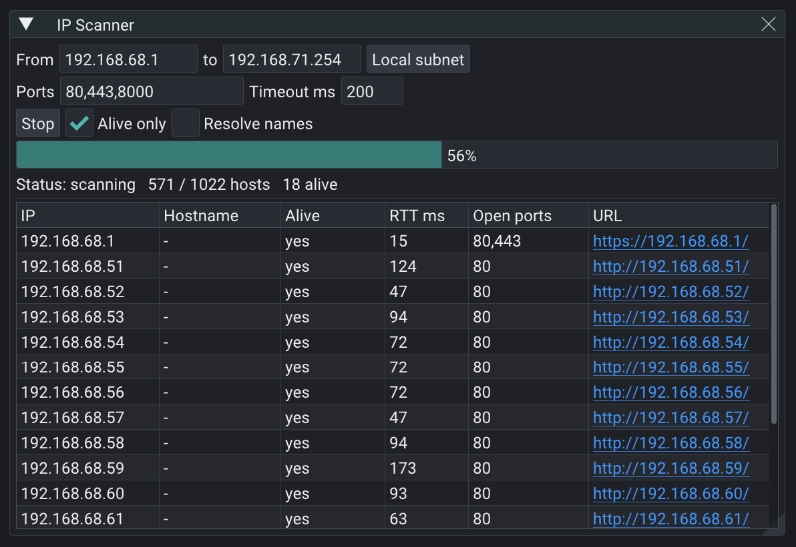

# netscan



IP Scanner-style over **rigNetScan**. The panel is `rigkit::IpScannerWindow` — any app that registers this pack can `createWindow` it once. TCP connect only (Pi floor). Local subnet fills the range; Start/Stop writes `CNetScan::running`.

```bash
cmake -S packs/rigNetScan/examples/netscan -B packs/rigNetScan/examples/netscan/build
cmake --build packs/rigNetScan/examples/netscan/build --target netscan
```

`--smoke-netscan` is the headless gate (loopback listen + scan `127.0.0.1`).
